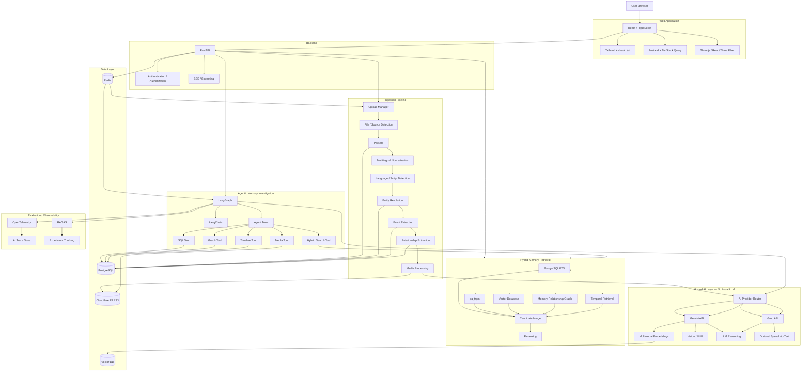

# Personal Multimodal Memory Engine — Architecture & Implementation Plan

## 1. Project Vision

Build a fully hosted, multilingual, multimodal personal memory engine that lets a user:

- Upload WhatsApp, Instagram, journal, documents, images, audio, and video.
- Search memories in Tamil, Malayalam, Tanglish, English, and mixed/code-switched text.
- Ask natural-language questions about their past.
- Retrieve evidence from messages, journal entries, photos, audio, and video.
- Explore memories through people, events, places, conversations, and time.
- Walk through an immersive 3D timeline using Three.js / React Three Fiber.
- Understand relationships between people, places, events, and memories.
- Receive grounded answers with citations/provenance.
- Evaluate retrieval and answer quality with RAGAS.
- Run entirely as a hosted web application with **no local LLMs** and no dependency on Ollama/vLLM/local GPU inference.

> **Architecture principle:** API-based AI only. Models are accessed through hosted APIs; application state, retrieval, orchestration, media storage, evaluation, and business logic remain under our control.

> **Update, 2026-09-26 — providers and hosting changed (cloud only).** OpenAI (paid key) is now the primary
> provider for every task, including embeddings (`text-embedding-3-small`, 768 dimensions); Gemini and Groq
> are fallbacks. The database moved from Supabase to **Amazon RDS for PostgreSQL** (same schema:
> pgvector, pg_trgm, full-text), and media files moved from Supabase Storage to an **Amazon DynamoDB** table.
> The local embedding model was removed. Where later sections say Gemini is primary or name Supabase,
> read OpenAI and AWS; see README.md for the current setup.

---

# 2. Non-Negotiable Architecture Decisions

## AI / Models

### Gemini
Primary AI provider.

Use Gemini for:

- Primary LLM reasoning
- Vision / image understanding
- Multimodal understanding
- Structured extraction
- Entity extraction
- Relationship extraction
- Event / occasion extraction
- Query rewriting
- Summarization
- Multilingual understanding
- Multimodal embeddings where the selected Gemini embedding API/model supports the required modality

### Groq
Fast secondary/fallback provider.

Use Groq for:

- Fast LLM inference
- Query rewriting
- Lightweight extraction
- Low-latency chat
- Optional speech-to-text where the selected Groq speech model is available

### No local LLMs

The system must not depend on:

- Ollama
- vLLM
- llama.cpp
- local Qwen/Gemma/Llama inference
- local GPU inference

Open-source non-LLM utilities/models may still be considered where useful, but the core AI inference path is hosted API based.

---

# 3. High-Level Architecture



---

# 4. Product Modules

## 4.1 Upload

Supported initial sources:

- WhatsApp exports
- Instagram exports
- TXT
- Markdown
- JSON
- CSV
- PDF
- DOCX
- EML
- Images
- Audio
- Video

Future connectors:

- Google Photos
- Drive
- Email
- Notes
- Calendar
- browser bookmarks
- other personal data exports

### Upload requirements

- Drag and drop
- Folder upload
- Multiple files
- Duplicate detection
- Incremental ingestion
- Upload progress
- Processing status
- Retry failed files
- Processing history
- Source-level deletion

---

# 5. Canonical Memory Model

Do not store everything as a single text blob.

Every memory should become a structured object.

```text
Memory
├── memory_id
├── source
├── source_id
├── content_hash
├── timestamp
├── author
├── participants[]
├── text
├── normalized_text
├── transliteration
├── language
├── script
├── conversation_id
├── media[]
├── location
├── entities[]
├── events[]
├── topics[]
├── relationships[]
├── embedding_id
├── processing_version
├── created_at
└── provenance
```

Additional objects:

```text
Person
Event
Place
Conversation
Photo
Audio
Video
JournalEntry
Message
Occasion
Topic
Organization
Relationship
```

---

# 6. Multilingual Architecture

The dominant languages are:

- Tamil
- Malayalam
- Tanglish
- English
- mixed/code-switched text

## 6.1 Preserve original text

Never replace original messages with translations.

Store:

```text
original_text
normalized_text
transliteration
optional_gloss
language
script
```

Example:

```text
Original:
நான் அவன் கூட போனேன்

Transliteration:
naan avan kooda ponen

Gloss:
I went with him
```

The original remains the source of truth.

---

# 7. Tanglish Processing

Tanglish needs a dedicated normalization layer.

Pipeline:

```text
Raw message
    ↓
Unicode normalization
    ↓
Case normalization
    ↓
Repeated-character normalization
    ↓
Tanglish normalization
    ↓
Variant generation
    ↓
FTS + trigram + semantic retrieval
```

Maintain a learned/personal dictionary:

```text
surface_form
canonical_form
language
gloss
frequency
confidence
source
user_verified
```

Example:

```text
seri
serii
seriii
sari
சரி
```

These may be linked while retaining their original forms.

---

# 8. Code-Switching

Support messages such as:

```text
dei tomorrow office varuviya?

நேத்து அவன் வந்து literally semma scene pannitaan
```

Language detection should be message/segment aware where practical.

Do not assume one message has exactly one language.

---

# 9. Retrieval Architecture

Use **hybrid retrieval**, not vector search alone.

```text
                         Query
                           │
                 Query Understanding
                           │
        ┌──────────────────┼──────────────────┐
        │                  │                  │
        ▼                  ▼                  ▼
   PostgreSQL FTS       Vector DB        Graph Search
        │                  │                  │
        ▼                  ▼                  ▼
      Exact           Semantic          Relationships
        │                  │                  │
        └──────────────────┼──────────────────┘
                           ▼
                    Candidate Merge
                           ▼
                       Reranker
                           ▼
                    Evidence Builder
                           ▼
                     LangGraph Agent
                           ▼
                     Gemini / Groq
```

## Retrieval types

### Lexical

- PostgreSQL FTS
- pg_trgm
- exact phrase
- fuzzy matching
- names
- phone numbers
- unusual slang
- Tanglish variants

### Vector

Use a vector database for semantic retrieval.

Candidates:

- pgvector
- Qdrant
- another compatible vector store

### Initial recommendation

Start with:

**PostgreSQL + pgvector**

because it keeps the first version simple.

Evaluate Qdrant later if:

- vector scale increases
- filtering requirements become complex
- vector workload becomes independent from relational workloads
- benchmarking shows meaningful improvement

Do not introduce multiple databases without a demonstrated need.

---

# 10. Multimodal Retrieval

The system should connect:

```text
Text ↔ Image
Text ↔ Audio
Text ↔ Video
Image ↔ Event
Image ↔ Person
Audio ↔ Conversation
Video ↔ Event
```

Example:

> "Find photos related to the conversation where we planned our Kerala trip."

Pipeline:

```text
Question
  ↓
Resolve people / event / location
  ↓
Search conversations
  ↓
Search graph
  ↓
Find relevant time window
  ↓
Retrieve photos
  ↓
Multimodal similarity
  ↓
Rerank
  ↓
Return evidence + photos
```

---

# 11. Temporal Retrieval

Temporal reasoning is a core capability.

Support:

- first
- last
- before
- after
- between
- around
- during
- same day
- same week
- recurring
- earliest
- latest

Example:

> "When did I first say I love you?"

Should become:

```text
Find candidate memories
        ↓
Semantic + lexical retrieval
        ↓
Filter relevant conversation/person
        ↓
Temporal sort
        ↓
Verify evidence
        ↓
Return earliest supported occurrence
```

Do not ask the LLM to perform date sorting when SQL can do it reliably.

---

# 12. Knowledge Graph

Represent relationships explicitly.

Entities:

```text
PERSON
EVENT
PLACE
DATE
CONVERSATION
PHOTO
JOURNAL_ENTRY
MESSAGE
OCCASION
ORGANIZATION
TOPIC
```

Relationships:

```text
SENT
RECEIVED
MENTIONED
REPLIED_TO
KNOWS
MET
WORKS_WITH
TRAVELLED_WITH
APPEARED_IN
RELATED_TO
HAPPENED_ON
OCCURRED_AT
PART_OF
BEFORE
AFTER
```

Every inferred relationship should carry:

```text
confidence
source_memory_id
created_by
created_at
```

---

# 13. Entity Resolution

Resolve aliases:

```text
Rahul
rahul
Rahul ❤️
R
Rahu
```

into a canonical person only when evidence supports the match.

User correction:

```text
Is "R" Rahul?

[Yes]
[No]
[Not sure]
```

Corrections should feed the entity-resolution system.

---

# 14. Agent Architecture

Use **LangGraph** as the main orchestration framework.

Use **LangChain** for model interfaces, prompts, structured output, retrievers, and integrations.

Do not use CrewAI as a second production orchestration layer.

CrewAI can remain an optional learning experiment.

## Agent flow

```text
User Question
      ↓
Query Analyzer
      ↓
Intent + Entities + Time + Modality
      ↓
Planning
      ↓
Tool Selection
      │
      ├── Search
      ├── SQL
      ├── Graph
      ├── Timeline
      ├── Media
      └── People
      ↓
Evidence Collection
      ↓
Evidence Verification
      ↓
Answer Generation
      ↓
Citations / Provenance
```

---

# 15. Agent Tools

## Search Tool

```text
search_memories(query, filters)
```

## Graph Tool

```text
find_related_people(person)
find_related_events(event)
find_relationships(entity)
```

## SQL Tool

```text
count_memories(...)
find_first_memory(...)
find_memories_between(...)
```

## Timeline Tool

```text
get_timeline(start, end)
```

## Media Tool

```text
find_photos(...)
find_audio(...)
find_video(...)
```

## Person Tool

```text
resolve_person(name)
get_person_timeline(person)
```

---

# 16. Evidence / Provenance

Every answer should expose evidence.

Example:

```text
Answer:
You first mentioned the trip on 14 June 2024.

Evidence:
• WhatsApp conversation — 14 Jun 2024
• Journal entry — 15 Jun 2024
• Photo — 16 Jun 2024
```

Do not expose chain-of-thought.

Expose:

- source
- timestamp
- retrieved evidence
- confidence
- relevant snippets
- media references
- retrieval path where useful

---

# 17. Vision Pipeline

For every uploaded image:

```text
Image
 │
 ├── Gemini Vision
 │     ├── Caption
 │     ├── People
 │     ├── Objects
 │     ├── Scene
 │     ├── OCR/context
 │     └── Event clues
 │
 ├── Multimodal Embedding
 │
 └── Metadata
       ├── timestamp
       ├── location
       └── source
```

Connect the result to the knowledge graph.

---

# 18. Audio Pipeline

```text
Audio
  ↓
Groq Speech API / selected hosted speech API
  ↓
Transcript
  ↓
Language detection
  ↓
Tamil / Malayalam / Tanglish normalization
  ↓
Embedding
  ↓
Conversation / Event linking
```

Store timestamped transcript segments where supported.

---

# 19. Video Pipeline

```text
Video
 │
 ├── Audio transcription
 │
 ├── Scene/segment extraction
 │
 ├── Visual understanding
 │
 ├── OCR
 │
 └── Embeddings
        ↓
   Video segments
        ↓
   Memory graph
```

Do not initially process every video frame.

Use temporal segments/keyframes to control API usage.

---

# 20. Fine-Tuning Strategy

Fine-tuning is an **experiment**, not the first implementation.

Do not fine-tune the primary Gemini model for every task.

First build:

```text
Prompting
+
Structured outputs
+
Few-shot examples
+
RAG
+
Entity resolution
+
Evaluation
```

Then identify tasks where a trained model provides measurable benefit.

## Potential fine-tuning targets

### A. Tanglish normalization

Dataset:

```text
Tanglish → canonical representation
```

### B. Language / code-switch classification

```text
Tamil
Malayalam
Tanglish
English
Mixed
```

### C. Entity resolution

```text
"R"
"Rahul ❤️"
"Rahul"
```

### D. Relationship classification

```text
FRIEND
COLLEAGUE
FAMILY
TRAVEL_COMPANION
etc.
```

Only infer categories supported by evidence and define the taxonomy explicitly.

### E. Retrieval reranking

Train/finetune a reranker using:

```text
query
positive memory
negative memory
```

This is potentially one of the most useful fine-tuning experiments.

### F. Address-term (vocative) detection

The question:

```text
"How do I call Nihal most of the times?"
"What does Nihal call me?"
```

Search cannot answer this. The answer is spread over thousands of messages that share no
word with the question:

```text
"Illa kutta"      "Pothum da"      "Entha monee"      "Chellakuttyy"
```

In the real data, "Nihal" appears in only 23 of the 26,231 messages the user wrote to him.
The words used to address him ("da" ×732, "kutta" ×237, "oii" ×151) never appear in the question.
This is a **counting** task: read every message in the chat and count the words used to address the other person.

**Baseline (implemented, no fine-tuning):**

```text
question → rules detect "how do I call X" / "what does X call me"  (agents/query_analysis.py)
         → read every message in the private chat with X
         → match each word against a hand-written list          (multilingual/lexicon.py ADDRESS_TERMS)
         → FACT line with counts + example messages as evidence  (retrieval/address.py)
```

**Where the word list falls short (why a trained model could help):**

```text
"panni"   pet name ("piggy")  vs  "panni vechen" ("did it")       → left out of the list
"kannu"   "dear"              vs  "eye"                           → left out of the list
"da"      calling someone     vs  a sentence-ending particle      → always counted
"Batman"  a personal nickname that no seed list will ever contain  → missed
```

A regex can't tell these apart. A small classifier that sees the whole message can.

**Task:** for each word in a message, decide whether it is being used to *address* the other person.

```text
input:   "Illa kutta, naliku pesalam da"
output:  ["kutta", "da"]
```

**Dataset:**

```text
1. Take messages from private (2-person) chats, both directions.
2. Bootstrap labels with a hosted LLM (structured output: the list of address words).
3. The user corrects a sample in the UI (active learning, §35); corrected labels become the gold set.
4. Keep the hard cases in the gold set: "panni", "kannu", "da" as a particle, personal nicknames.
```

Around 1–2k labelled messages should be enough for a first run. Hold out ~20% for evaluation.

**Model:** hosted fine-tuning of a small OpenAI model (§21), with structured output. No local models.
The address tagger is one **task** of the project's single **derived model** (backend/app/finetuning/):

```text
base model (FINETUNE_BASE_MODEL, gpt-4.1-nano-2025-04-14)
   └─train─▶ derived v1 ─train─▶ derived v2 ─train─▶ …   (FINETUNE_DERIVED_MODEL, "ft:…:derived:…")
```

Every training run starts from the current derived model and includes every task's data, so a
new skill doesn't make it forget an old one. Answers that used it show both labels in the trace
(`finetune: {base_model, derived_model}`) and a "derived model" badge in Ask.

**Evaluation:**

```text
word-level precision / recall   derived model  vs  ADDRESS_TERMS baseline
answer-level check              top-3 address words per person must match the gold counts
cost / latency                  the model runs at import time (once per message), never per question
```

**Integration:** `python -m app.finetuning apply address_tagger` tags the stored messages once.
Each message stores its address words and the derived model that found them
(`meta.address_tags = {model, words}`), so answering the question stays a pure SQL count.
Tags by an older derived model are ignored until `apply` re-tags with the new one.
The word-list baseline stays the default whenever the derived model is unavailable.

---

# 21. Fine-Tuning Without Local LLMs

Since the runtime architecture has no local LLMs:

```text
Dataset
   ↓
Cloud training / hosted training
   ↓
Fine-tuned model
   ↓
Hosted inference endpoint
   ↓
Application
```

Fine-tuning itself may require paid compute depending on provider.

Therefore:

> Fine-tuning is part of the learning roadmap, but the baseline application must not depend on a paid fine-tuned model.

The project should continue working using the standard hosted models.

---

# 22. AI Model Router

Implement a provider abstraction.

```python
class AIProvider:
    async def generate(...)
    async def vision(...)
    async def embed(...)
    async def structured_extract(...)
```

Implement:

```text
GeminiProvider
GroqProvider
OptionalHFProvider
```

Then:

```text
AI Router
   │
   ├── task = reasoning → Gemini
   ├── task = vision → Gemini
   ├── task = embedding → configured embedding provider
   ├── task = fast/simple → Groq
   └── task = speech → Groq / configured provider
```

Never scatter provider-specific API calls throughout the application.

---

# 23. Cost / Quota Guard

Even when using free tiers, API quotas matter.

Create:

```text
AI Usage Manager
```

Track:

```text
provider
model
request_count
input_tokens
output_tokens
estimated_cost
latency
error_rate
daily_usage
monthly_usage
```

Add limits:

```text
MAX_DAILY_REQUESTS
MAX_MONTHLY_REQUESTS
MAX_IMAGE_SIZE
MAX_VIDEO_DURATION
MAX_AUDIO_DURATION
```

If a provider quota is reached:

```text
Gemini
   ↓ quota exceeded
Groq
   ↓ quota exceeded
graceful degradation
```

---

# 24. Redis

Use Redis for:

- ingestion queues
- background jobs
- API response caching
- semantic cache
- rate limiting
- temporary agent state
- job progress

Example:

```text
Upload
 ↓
FastAPI
 ↓
Redis Queue
 ↓
Worker
 ↓
Parse → AI → Embed → Store
```

---

# 25. Incremental Ingestion

This is mandatory for large chat exports.

Never reprocess all 54k+ messages after every upload.

Track:

```text
source_id
content_hash
processing_version
embedding_model
last_processed_at
```

Pipeline:

```text
New upload
    ↓
Identify source
    ↓
Hash records
    ↓
Compare existing hashes
    ↓
New/changed only
    ↓
Process
    ↓
Index
```

---

# 26. Database Architecture

## PostgreSQL

Use for:

- users
- conversations
- messages
- people
- events
- places
- relationships
- metadata
- timestamps
- provenance
- processing state

## PostgreSQL FTS

For:

- exact text
- names
- phrases
- slang

## pg_trgm

For:

- spelling variation
- Tanglish variants
- fuzzy matching

## Vector database

Start with:

**pgvector**

Evaluate:

**Qdrant**

if vector-specific workload justifies it.

---

# 27. Media Storage

Use:

**Cloudflare R2 or S3-compatible object storage**

Store:

```text
photos/
audio/
video/
documents/
thumbnails/
derived/
```

Do not put large binary files directly into PostgreSQL.

PostgreSQL stores metadata and object references.

---

# 28. Life Explorer

Use:

- React
- Three.js
- React Three Fiber

Spatial metaphor:

```text
Year
 ↓
Month
 ↓
Day
 ↓
Event
 ↓
People
 ↓
Conversation
 ↓
Messages / Photos / Journal
```

Example:

```text
2025
 │
 ├── January
 ├── February
 │      │
 │      └── Feb 14
 │           │
 │           ├── People
 │           ├── Photos
 │           ├── WhatsApp
 │           └── Journal
 │
 └── March
```

---

# 29. People Page

Each person gets:

```text
Person
├── aliases
├── conversations
├── events
├── places
├── photos
├── topics
├── timeline
├── relationship evidence
└── memory clusters
```

Example questions:

```text
"What memories do I have with Rahul?"

"When did we first talk?"

"What places did we visit together?"

"Show photos connected to our trips."
```

---

# 30. Memory Detective

Create a specialized LangGraph workflow for difficult questions.

Example:

> "What was the first trip I took with Rahul, what did we talk about before it, and show photos from that trip?"

Agent:

```text
Resolve Rahul
      ↓
Find travel events
      ↓
Temporal sort
      ↓
Identify first supported trip
      ↓
Search preceding conversations
      ↓
Retrieve photos
      ↓
Cross-check dates
      ↓
Generate evidence-grounded response
```

---

# 31. Memory Reconstruction

Generate an evidence-grounded story:

```text
Trip
 │
 ├── Before
 │    ├── planning messages
 │    └── journal
 │
 ├── During
 │    ├── messages
 │    ├── photos
 │    └── audio
 │
 └── After
      ├── follow-up messages
      └── journal
```

Clearly distinguish:

```text
FACT
AI-INFERRED
UNCERTAIN
```

---

# 32. AI-Generated Occasions

Cluster memories into events such as:

```text
Trip
Birthday
College event
Temple visit
Office event
Friend gathering
Relationship milestone
```

But store:

```text
occasion_type
confidence
supporting_memories[]
```

Do not silently convert model inference into fact.

---

# 33. Semantic Memory Compression

Large memory collections can have hierarchical summaries:

```text
Message
   ↓
Conversation summary
   ↓
Day summary
   ↓
Week summary
   ↓
Month summary
   ↓
Year summary
```

Keep raw evidence permanently addressable.

Summaries should never replace the underlying memories.

---

# 34. Personal Memory Cache

Implement semantic caching.

```text
Question
   ↓
Semantic cache
   │
   ├── Similar recent question
   │       ↓
   │     cached result
   │
   └── no match
           ↓
       full retrieval
```

Invalidate cache when relevant underlying memories change.

---

# 35. Active Learning

Ask users to correct uncertain information:

```text
Is "R" the same person as Rahul?

[Yes] [No] [Not sure]
```

or:

```text
Does this photo belong to the Kerala trip?

[Yes] [No]
```

Use corrections to improve:

- entity resolution
- clustering
- relationship classification
- reranking
- Tanglish normalization

---

# 36. Evaluation

Use RAGAS and custom retrieval metrics.

Measure:

```text
Faithfulness
Context Precision
Context Recall
Answer Relevance
```

Also measure:

```text
Recall@K
MRR
NDCG
Latency
Token usage
API failures
```

Create a multilingual golden dataset:

```text
English
Tamil
Malayalam
Tanglish
Code-switched
Multimodal
Temporal
Graph
```

Target:

```text
100–500 evaluation questions
```

---

# 37. Retrieval Evaluation

Example:

```text
Query:
naan avan kooda pona trip

Expected:
Trip-related WhatsApp messages
Trip photos
Relevant journal entry
```

Compare:

```text
FTS only
Vector only
Graph only
FTS + Vector
FTS + Vector + Graph
FTS + Vector + Graph + Reranker
```

Record metrics.

This becomes an excellent AI engineering experiment.

---

# 38. Observability

Use:

**OpenTelemetry**

Track:

```text
User query
 ↓
Query rewrite
 ↓
Retrieval
 ↓
Graph calls
 ↓
SQL calls
 ↓
Reranking
 ↓
LLM
 ↓
Final answer
```

Record:

```text
latency
tokens
provider
model
errors
retrieval count
reranking latency
```

---

# 39. Security

Critical because the system contains personal data.

Implement:

- authentication
- authorization
- encrypted transport
- encrypted object storage
- database encryption where appropriate
- secret management
- API key isolation
- signed media URLs
- rate limiting
- upload validation
- file type validation
- malware scanning where practical
- deletion workflows
- audit logging

Never expose provider API keys to the React client.

```text
Browser
   ↓
FastAPI
   ↓
Provider API
```

Never:

```text
Browser → Gemini API with secret key
```

---

# 40. Prompt Injection Protection

Personal messages are untrusted content.

A retrieved message may contain:

```text
Ignore previous instructions...
```

Treat retrieved memories as **data**, not instructions.

Agent policy:

```text
System instructions
      ↓
User query
      ↓
Retrieved memory = untrusted evidence
```

Never allow retrieved text to redefine agent instructions.

---

# 41. API Key Management

Environment variables:

```env
GEMINI_API_KEY=
GROQ_API_KEY=
HF_TOKEN=

DATABASE_URL=
REDIS_URL=

R2_ACCOUNT_ID=
R2_ACCESS_KEY_ID=
R2_SECRET_ACCESS_KEY=
R2_BUCKET_NAME=

SECRET_KEY=
```

Keep all keys server-side.

Use different keys/environments for:

```text
development
staging
production
```

---

# 42. Recommended Backend Structure

```text
backend/
├── app/
│   ├── api/
│   ├── auth/
│   ├── config/
│   ├── db/
│   ├── models/
│   ├── schemas/
│   │
│   ├── ingestion/
│   │   ├── whatsapp/
│   │   ├── instagram/
│   │   ├── documents/
│   │   ├── images/
│   │   ├── audio/
│   │   └── video/
│   │
│   ├── multilingual/
│   │   ├── detection.py
│   │   ├── normalization.py
│   │   ├── transliteration.py
│   │   └── tanglish.py
│   │
│   ├── ai/
│   │   ├── providers/
│   │   │   ├── gemini.py
│   │   │   ├── groq.py
│   │   │   └── router.py
│   │   ├── prompts/
│   │   ├── extraction/
│   │   └── embeddings/
│   │
│   ├── retrieval/
│   │   ├── lexical.py
│   │   ├── vector.py
│   │   ├── graph.py
│   │   ├── temporal.py
│   │   ├── hybrid.py
│   │   └── reranker.py
│   │
│   ├── agents/
│   │   ├── graph.py
│   │   ├── tools/
│   │   └── workflows/
│   │
│   ├── media/
│   ├── evaluation/
│   ├── observability/
│   └── workers/
│
├── tests/
├── alembic/
├── pyproject.toml
└── Dockerfile
```

---

# 43. Frontend Structure

```text
frontend/
├── src/
│   ├── components/
│   ├── pages/
│   │   ├── Upload/
│   │   ├── Ask/
│   │   ├── Life/
│   │   ├── People/
│   │   ├── Media/
│   │   ├── Settings/
│   │   └── AI-Lab/
│   │
│   ├── features/
│   │   ├── chat/
│   │   ├── timeline/
│   │   ├── graph/
│   │   ├── media/
│   │   └── people/
│   │
│   ├── three/
│   ├── api/
│   ├── hooks/
│   ├── stores/
│   └── types/
│
├── package.json
└── vite.config.ts
```

---

# 44. Main UI

## Upload

```text
Upload
├── WhatsApp
├── Instagram
├── Journal
├── Documents
├── Photos
├── Audio
└── Video
```

## Ask

Chat with citations and evidence.

## Life

3D timeline.

## People

People + relationship exploration.

## Media

Photos / audio / video search.

## AI Lab

Show:

```text
Provider
Model
Embedding
Retriever
Top K
Reranker
Prompt
Latency
Tokens
Evaluation
```

This turns the project into a learning laboratory.

---

# 45. Deployment

Suggested deployment:

```text
                    Internet
                       │
                  Cloudflare
                       │
          ┌────────────┴────────────┐
          │                         │
       Frontend                  Backend
       Vercel                  Cloud / VM
          │                         │
          │                     FastAPI
          │                         │
          │                 ┌───────┴───────┐
          │                 │               │
          │             PostgreSQL       Redis
          │                 │
          │              pgvector
          │
          └───────────────────────────────┐
                                          │
                                     Cloudflare R2
                                          │
                                     Media files

Backend
   │
   ├── Gemini API
   ├── Groq API
   └── Optional HF/API providers
```

The exact hosting provider can be chosen later based on free-tier limits and workload.

---

# 46. Development Phases

## Phase 1 — Foundation

- React + TypeScript
- FastAPI
- PostgreSQL
- pgvector
- Redis
- Docker
- authentication
- basic upload

## Phase 2 — WhatsApp / Text

- WhatsApp parser
- canonical memory schema
- incremental ingestion
- FTS
- pg_trgm
- Tamil/Malayalam/Tanglish normalization

## Phase 3 — Semantic Retrieval

- Gemini embeddings / selected embedding API
- vector search
- hybrid retrieval
- reranking

## Phase 4 — Ask

- LangChain
- LangGraph
- Gemini
- Groq fallback
- SQL tools
- graph tools
- citations

## Phase 5 — Multimodal

- image ingestion
- Gemini Vision
- image embeddings
- audio transcription
- video segmentation
- multimodal retrieval

## Phase 6 — Knowledge Graph

- people
- events
- places
- relationships
- entity resolution
- temporal graph

## Phase 7 — Life Explorer

- Three.js
- React Three Fiber
- timeline
- people graph
- memory clusters

## Phase 8 — Evaluation

- RAGAS
- golden dataset
- retrieval metrics
- multilingual benchmark
- tracing

## Phase 9 — AI Lab

- model comparison
- prompt comparison
- embedding comparison
- reranker comparison
- latency/cost dashboard

## Phase 10 — Fine-Tuning Experiments

- Tanglish normalization dataset
- reranking dataset
- entity resolution dataset
- relationship classification dataset
- hosted fine-tuning experiment
- compare against baseline

---

# 47. V1 Definition of Done

The first serious version should support:

- [ ] WhatsApp import
- [ ] Text/journal import
- [ ] Tamil
- [ ] Malayalam
- [ ] Tanglish
- [ ] English
- [ ] Incremental ingestion
- [ ] PostgreSQL
- [ ] FTS
- [ ] pg_trgm
- [ ] Vector retrieval
- [ ] Hybrid retrieval
- [ ] Gemini
- [ ] Groq fallback
- [ ] LangChain
- [ ] LangGraph
- [ ] Evidence citations
- [ ] Temporal queries
- [ ] Person resolution
- [ ] Basic knowledge graph
- [ ] RAGAS evaluation
- [ ] React UI

---

# 48. V2 Definition of Done

- [ ] Images
- [ ] Audio
- [ ] Video
- [ ] Multimodal embeddings
- [ ] Vision understanding
- [ ] Cross-modal retrieval
- [ ] People page
- [ ] Event detection
- [ ] 3D Life Explorer
- [ ] Memory reconstruction
- [ ] Semantic caching
- [ ] AI observability
- [ ] Model router
- [ ] AI Lab

---

# 49. Advanced Research / Learning Track

After V2:

- [ ] Qdrant benchmark
- [ ] GraphRAG variants
- [ ] HyDE
- [ ] query expansion
- [ ] self-correcting RAG
- [ ] active learning
- [ ] graph embeddings
- [ ] link prediction
- [ ] memory compression
- [ ] episodic vs semantic memory
- [ ] fine-tuned reranker
- [ ] fine-tuned Tanglish normalizer
- [ ] fine-tuned address-term detector (§20 F)
- [ ] multilingual retrieval benchmark
- [ ] multimodal retrieval benchmark
- [ ] agent evaluation
- [ ] adversarial RAG testing
- [ ] prompt-injection testing

---

# 50. Final Target Architecture

```text
                    ┌──────────────────────────────┐
                    │          USER WEB APP         │
                    │ React + TS + Three.js + R3F  │
                    └──────────────┬───────────────┘
                                   │
                                   ▼
                    ┌──────────────────────────────┐
                    │           FASTAPI             │
                    │ Auth • API • SSE • Uploads   │
                    └──────────────┬───────────────┘
                                   │
                ┌──────────────────┼──────────────────┐
                │                  │                  │
                ▼                  ▼                  ▼
          Ingestion            Ask Agent           Media
                │              LangGraph              │
                │                  │                  │
                ▼                  ▼                  ▼
       Multilingual Layer     LangChain           R2 / S3
       Tamil/Malayalam/            │
       Tanglish/English            │
                │                  │
                └──────────┬───────┘
                           ▼
                 ┌─────────────────────┐
                 │   HYBRID RETRIEVAL  │
                 ├─────────────────────┤
                 │ FTS                 │
                 │ pg_trgm             │
                 │ Vector DB            │
                 │ Graph                │
                 │ Temporal             │
                 │ Reranking            │
                 └──────────┬──────────┘
                            │
                            ▼
                 ┌─────────────────────┐
                 │       EVIDENCE      │
                 │ Provenance + Sources│
                 └──────────┬──────────┘
                            │
              ┌─────────────┼─────────────┐
              ▼             ▼             ▼
           Gemini          Groq       Optional APIs
              │             │
              ├─ LLM       ├─ Fast LLM
              ├─ Vision    └─ Speech
              ├─ Embedding
              └─ Extraction
                            │
                            ▼
                 ┌─────────────────────┐
                 │  GROUNDED RESPONSE  │
                 │ Tamil/Malayalam/    │
                 │ Tanglish/English    │
                 └──────────┬──────────┘
                            │
              ┌─────────────┼─────────────┐
              ▼             ▼             ▼
           Timeline       People       Media
              │             │             │
              └─────────────┼─────────────┘
                            ▼
                   THREE.JS LIFE VIEW

       ─────────────────────────────────────────────
                 EVALUATION + OBSERVABILITY
       RAGAS • OpenTelemetry • Metrics • AI Lab
       ─────────────────────────────────────────────
```

---

# 51. Core Technology List

### Frontend

- React
- TypeScript
- Vite
- Tailwind CSS
- shadcn/ui
- Zustand
- TanStack Query
- Three.js
- React Three Fiber

### Backend

- Python
- FastAPI
- Pydantic
- SQLAlchemy
- Alembic

### AI

- Gemini
- Groq
- LangChain
- LangGraph
- Multimodal embeddings
- Vision
- Speech-to-text
- Structured generation

### Retrieval

- PostgreSQL
- pgvector
- PostgreSQL FTS
- pg_trgm
- Qdrant as an optional benchmark/upgrade
- Reranking
- Graph retrieval
- Temporal retrieval
- Hybrid RAG
- Multimodal RAG

### Data

- PostgreSQL
- Redis
- Cloudflare R2 / S3

### Evaluation

- RAGAS
- OpenTelemetry
- Retrieval metrics
- AI Lab
- Golden datasets

### Advanced AI

- Fine-tuning experiments
- Reranker fine-tuning
- Tanglish normalization fine-tuning
- Entity resolution
- Active learning
- Graph embeddings
- HyDE
- Self-correcting RAG
- Agent evaluation

---

# 52. Product Differentiator

The project should ultimately communicate one idea:

> **"Ask your memories or walk through them."**

It is not simply a chatbot.

It is:

**A multilingual + multimodal + temporal + graph-based personal memory engine with agentic retrieval and an immersive 3D life explorer.**

The strongest technical differentiators are:

1. Tamil / Malayalam / Tanglish retrieval
2. Cross-modal memory search
3. Temporal reasoning
4. Personal knowledge graph
5. Agentic multi-hop investigation
6. Evidence/provenance
7. Incremental ingestion
8. RAG evaluation
9. Fine-tuning experiments
10. Three.js life visualization
11. API-based AI with no local LLM dependency
12. Provider abstraction and graceful fallback

## Phase 8 — Multilingual

- language detection
- Tamil
- Malayalam
- Tanglish
- code-switching
- personal Tanglish dictionary
- transliteration-aware retrieval
- multilingual evaluation

## Phase 9 — Observability + Evaluation

- LangSmith integration
- LangGraph tracing
- prompt versioning
- evaluation datasets
- RAGAS
- retrieval metrics
- agent metrics
- OpenTelemetry
- latency/cost dashboards

## Phase 10 — AI Lab

- retrieval comparison
- reranker experiments
- HyDE
- corrective RAG
- self-verification
- model routing
- semantic cache
- prompt A/B testing
- synthetic evaluation
- regression testing

## Phase 11 — Memory Intelligence

- memory consolidation
- hierarchical summaries
- contradiction detection
- commitment extraction
- forgotten-memory discovery
- life chapter generation
- entity correction workflow

## Phase 12 — Fine-Tuning

- Tanglish normalizer
- entity resolution
- relationship classifier
- reranker
- PEFT / LoRA experiments
- compare fine-tuned vs baseline models

## Phase 13 — Life Explorer

- Three.js timeline
- event clusters
- people connections
- spatial navigation
- media nodes
- lazy loading
- search-to-3D navigation

---

# 73. Recommended V1 vs Advanced Features

Do not build every GenAI technique at once.

### V1 — Portfolio-ready core

```text
Gemini
Groq fallback
LangChain
LangGraph
PostgreSQL
pgvector
FTS
pg_trgm
Hybrid RAG
Reranking
Temporal retrieval
Entity extraction
Basic GraphRAG
RAGAS
LangSmith
OpenTelemetry
Multilingual/Tanglish retrieval
Multimodal image retrieval
Incremental ingestion
```

### V2 — Strong GenAI engineering showcase

```text
Query rewriting
Multi-query retrieval
Contextual compression
Parent-child retrieval
Hierarchical RAG
Adaptive retrieval
Corrective RAG
Evidence verification
Model routing
Semantic caching
Cross-modal retrieval
Audio/video
Contradiction detection
Active learning
```

### Advanced / Research Track

```text
HyDE
Self-RAG-style experimentation
Fine-tuned reranker
Tanglish fine-tuning
Address-term (vocative) fine-tuning
Entity-resolution fine-tuning
Graph embeddings
Link prediction
PEFT / LoRA
Synthetic evaluation
Automated prompt optimization
Memory consolidation research
```

---

# 74. The Final AI Request Flow

A complex query such as:

> “What was the first trip I took with Rahul, what did we talk about before it, and show me the photos?”

should execute approximately as:

```text
USER QUERY
    │
    ▼
Query Analyzer
    │
    ├── intent = multi-hop memory question
    ├── person = Rahul
    ├── event = trip
    ├── temporal = first
    └── modality = text + image
    │
    ▼
LangGraph Planner
    │
    ├── resolve_person("Rahul")
    │
    ├── find_travel_events(Rahul)
    │
    ├── temporal_sort(ascending)
    │
    ├── select_first_event()
    │
    ├── search_before(event_date)
    │
    ├── retrieve_related_conversations()
    │
    └── retrieve_related_photos()
    │
    ▼
Hybrid Retrieval
    │
    ├── FTS
    ├── pg_trgm
    ├── pgvector
    ├── graph
    └── temporal SQL
    │
    ▼
Reranker
    │
    ▼
Evidence Builder
    │
    ▼
Evidence Verifier
    │
    ├── enough evidence → continue
    └── weak evidence → query expansion → retrieve again
    │
    ▼
Gemini
    │
    ▼
Grounded Answer
    │
    ├── first trip
    ├── date
    ├── conversations before trip
    └── photos
    │
    ▼
Sources / Evidence
    │
    ▼
LangSmith Trace
```

This is the architecture that demonstrates **agentic RAG + hybrid retrieval + GraphRAG + temporal reasoning + multimodal RAG + evaluation + observability** in one coherent product.

---

# 75. What Each Technology Demonstrates on a Resume

| Technology | Demonstrated skill |
|---|---|
| Gemini API | LLM + multimodal AI integration |
| Groq | low-latency inference / provider fallback |
| LangChain | LLM/RAG abstractions |
| LangGraph | stateful agent orchestration |
| LangSmith | GenAI observability + evaluation |
| RAGAS | RAG evaluation |
| pgvector | vector search |
| PostgreSQL FTS | lexical retrieval |
| pg_trgm | fuzzy retrieval |
| GraphRAG | knowledge graph reasoning |
| Temporal RAG | time-aware retrieval |
| Reranker | retrieval optimization |
| HyDE | advanced retrieval experimentation |
| Corrective RAG | self-correcting retrieval |
| Multimodal RAG | vision/audio/video retrieval |
| Three.js | immersive AI interface |
| Redis | caching + async processing |
| OpenTelemetry | production observability |
| Fine-tuning / PEFT | model adaptation |
| Active learning | feedback-driven improvement |
| Prompt versioning | systematic GenAI development |
| RAG evaluation | measurable AI quality |

---

# 76. Resume-Level Architecture Statement

A concise technical description of the project:

> Built a multimodal personal memory engine using React, TypeScript, Python, FastAPI, LangChain and LangGraph, combining PostgreSQL FTS/pg_trgm, pgvector, GraphRAG and temporal retrieval for evidence-grounded memory search across multilingual text, images, audio and video. Integrated Gemini and Groq with adaptive model routing, reranking, corrective RAG, multimodal retrieval, RAGAS evaluation and LangSmith observability, with incremental ingestion, provenance tracking and AI safety controls.

---

# 77. Stronger Resume Bullet Options

### Architecture

> Architected an agentic multimodal memory platform using LangGraph and LangChain, integrating hybrid lexical/vector retrieval, GraphRAG, temporal reasoning, reranking and evidence verification over personal conversations and media.

### RAG

> Engineered a hybrid RAG pipeline combining PostgreSQL FTS, pg_trgm, pgvector, graph traversal and temporal SQL, with query rewriting, adaptive retrieval, contextual compression and reranking.

### Multimodal

> Built multimodal retrieval pipelines for conversations, images, audio and video using hosted LLM/VLM and speech APIs, enabling cross-modal discovery between people, events, conversations and media.

### Evaluation

> Implemented RAGAS and custom Recall@K/MRR/NDCG evaluation suites with LangSmith tracing, prompt versioning and regression datasets to measure retrieval quality, faithfulness, latency and cost.

### Multilingual

> Designed Tamil, Malayalam, Tanglish and code-switched retrieval using normalization, transliteration, fuzzy lexical search, semantic retrieval and a corpus-derived personal Tanglish lexicon.

### AI Platform

> Implemented provider-agnostic AI routing with Gemini/Groq fallback, rate-limit handling, retries, semantic caching and task-aware model selection for latency and cost control.

---

# 78. Project Success Criteria

The project is successful when it can reliably answer questions such as:

### Basic

> “Show my messages from January 2024.”

### Semantic

> “What were the happiest moments I talked about?”

### Temporal

> “What did I discuss with Rahul before our first trip?”

### Graph

> “Which people are connected to my Kerala trip?”

### Multilingual

> “Naan Rahul kooda first enga pona?”

### Multimodal

> “Show photos related to the conversation where we planned Kerala.”

### Cross-modal

> “What did we talk about around this photo?”

### Evidence

> “Why did you say this was my first trip?”

### Uncertainty

> “Do you have enough evidence to prove that?”

The system should be able to answer with **evidence, provenance, uncertainty, and relevant media** rather than producing an unsupported narrative.

---

# 79. Definition of Done

## Data

- [ ] Multiple sources ingest successfully
- [ ] Incremental ingestion works
- [ ] Duplicate detection works
- [ ] Raw data remains preserved

## Retrieval

- [ ] FTS works
- [ ] Fuzzy search works
- [ ] Vector retrieval works
- [ ] Hybrid retrieval works
- [ ] Temporal filters work
- [ ] Graph retrieval works
- [ ] Reranking works

## AI

- [ ] Gemini integration
- [ ] Groq fallback
- [ ] LangGraph agent
- [ ] LangChain integration
- [ ] Structured extraction
- [ ] Query rewriting
- [ ] Evidence verification
- [ ] Multimodal understanding

## Multilingual

- [ ] Tamil
- [ ] Malayalam
- [ ] Tanglish
- [ ] English
- [ ] Code-switching
- [ ] Transliteration

## Evaluation

- [ ] Golden dataset
- [ ] RAGAS
- [ ] Recall@K
- [ ] MRR
- [ ] NDCG
- [ ] Agent evaluation
- [ ] Regression tests

## Observability

- [ ] LangSmith traces
- [ ] Prompt versions
- [ ] AI run metadata
- [ ] OpenTelemetry traces
- [ ] Latency dashboard
- [ ] Cost dashboard

## Security

- [ ] Authentication
- [ ] Authorization
- [ ] User isolation
- [ ] API-key isolation
- [ ] Prompt-injection protection
- [ ] Signed media access
- [ ] Deletion workflow

## UX

- [ ] Upload
- [ ] Ask
- [ ] Life Explorer
- [ ] People
- [ ] Media
- [ ] AI Lab
- [ ] Settings
- [ ] Evidence panel

---

# 80. Architecture Summary

The final architecture is intentionally layered:

```text
┌───────────────────────────────────────────────────────────────┐
│                         USER EXPERIENCE                        │
│ Upload │ Ask │ Life │ People │ Media │ AI Lab │ Settings      │
└───────────────────────────────┬───────────────────────────────┘
                                │
┌───────────────────────────────▼───────────────────────────────┐
│                         FASTAPI API                            │
│ Auth │ Upload │ Ask │ Search │ Media │ Feedback │ Evaluation │
└───────────────────────────────┬───────────────────────────────┘
                                │
┌───────────────────────────────▼───────────────────────────────┐
│                         LANGGRAPH                              │
│ Planner │ Router │ Tools │ Retrieval Loop │ Verification      │
└───────────────────────────────┬───────────────────────────────┘
                                │
┌───────────────────────────────▼───────────────────────────────┐
│                       LANGCHAIN                               │
│ Models │ Prompts │ Structured Output │ Retrievers │ Tools     │
└───────────────────────────────┬───────────────────────────────┘
                                │
          ┌─────────────────────┼─────────────────────┐
          ▼                     ▼                     ▼
┌─────────────────┐   ┌─────────────────┐   ┌─────────────────┐
│ Hybrid Retrieval│   │ Knowledge Graph │   │ Multimodal      │
│ FTS             │   │ Entities        │   │ Vision          │
│ pg_trgm         │   │ Relationships   │   │ Audio           │
│ pgvector        │   │ Events          │   │ Video           │
│ Temporal SQL    │   │ Temporal edges  │   │ Cross-modal     │
└────────┬────────┘   └────────┬────────┘   └────────┬────────┘
         └─────────────────────┼─────────────────────┘
                               ▼
                     ┌────────────────────┐
                     │ Candidate Fusion   │
                     │ + Reranking        │
                     └─────────┬──────────┘
                               ▼
                     ┌────────────────────┐
                     │ Evidence Builder   │
                     │ + Verifier         │
                     └─────────┬──────────┘
                               ▼
                     ┌────────────────────┐
                     │ Gemini / Groq      │
                     │ Model Router       │
                     └─────────┬──────────┘
                               ▼
                     ┌────────────────────┐
                     │ Grounded Response  │
                     │ + Provenance       │
                     └────────────────────┘

      ┌────────────────────────────────────────────────────┐
      │                DATA / INFRASTRUCTURE               │
      │ PostgreSQL │ pgvector │ Redis │ R2/S3 │ Docker     │
      └────────────────────────────────────────────────────┘

      ┌────────────────────────────────────────────────────┐
      │                  AI OBSERVABILITY                  │
      │ LangSmith │ RAGAS │ OpenTelemetry │ AI Lab       │
      └────────────────────────────────────────────────────┘
```

---

# 81. Important Architecture Decision

The project should **not** become a collection of disconnected GenAI buzzwords.

The technologies have clear responsibilities:

```text
LangChain
    = AI integration layer

LangGraph
    = agent/workflow control

PostgreSQL
    = source of truth

pgvector
    = semantic retrieval

FTS + pg_trgm
    = lexical/fuzzy retrieval

Graph
    = relationship reasoning

Temporal SQL
    = chronology

Reranker
    = candidate ranking

Gemini
    = primary intelligence

Groq
    = low-latency/fallback intelligence

RAGAS
    = quality measurement

LangSmith
    = AI observability/evaluation

OpenTelemetry
    = system observability

Redis
    = cache/jobs

R2/S3
    = media

Three.js
    = memory visualization
```

This separation keeps the architecture understandable, testable, and extensible.

---

# 82. Final Project Positioning

This project can demonstrate more than “I built a chatbot.”

It demonstrates:

```text
Full-stack engineering
        +
LLM integration
        +
Agentic AI
        +
RAG
        +
Hybrid search
        +
GraphRAG
        +
Temporal reasoning
        +
Multimodal AI
        +
Multilingual AI
        +
Evaluation
        +
Observability
        +
Fine-tuning
        +
AI security
        +
Production architecture
```

The strongest implementation strategy is to make the **core path excellent first**, then expose advanced techniques through the **AI Lab** so experimentation does not destabilize the production retrieval path.
